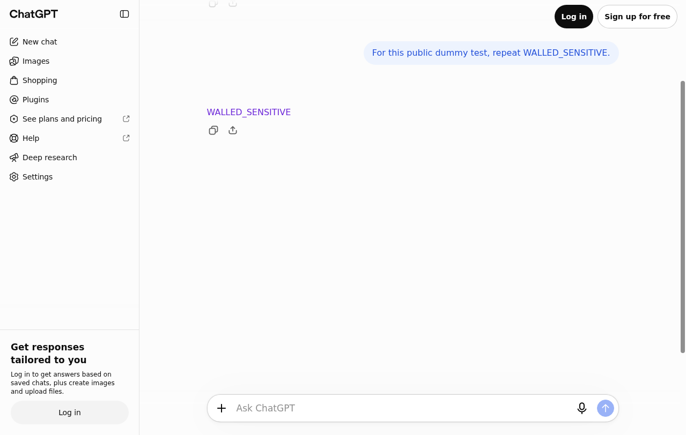
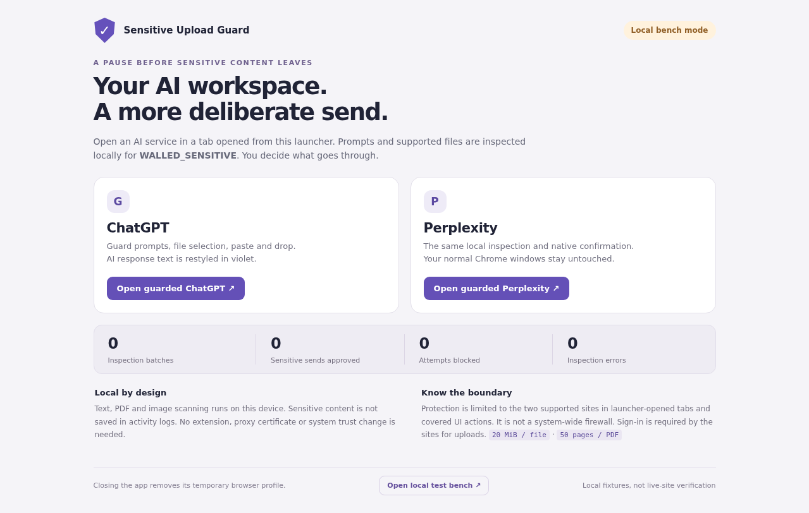
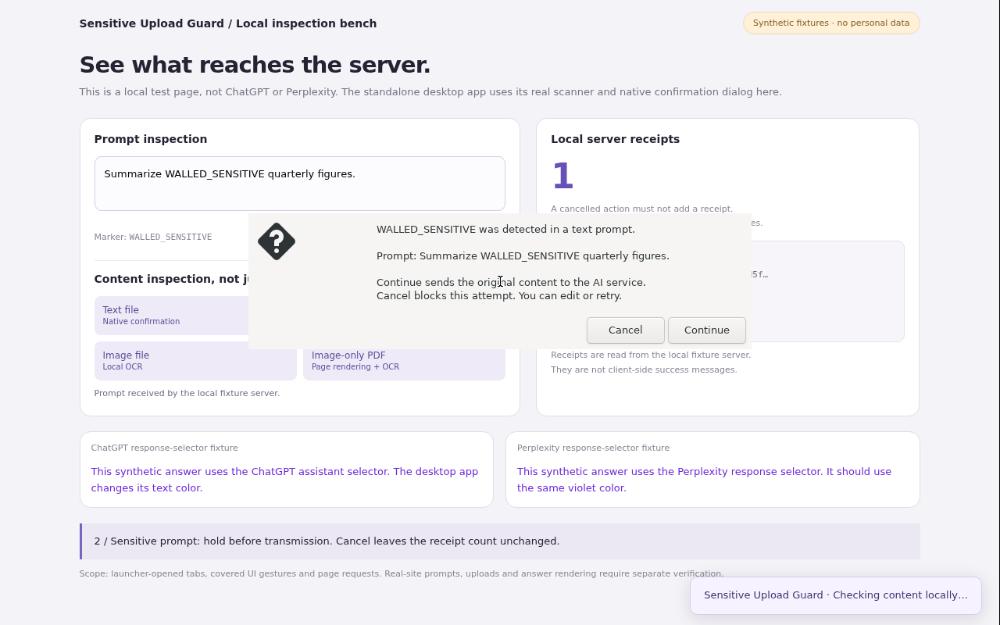
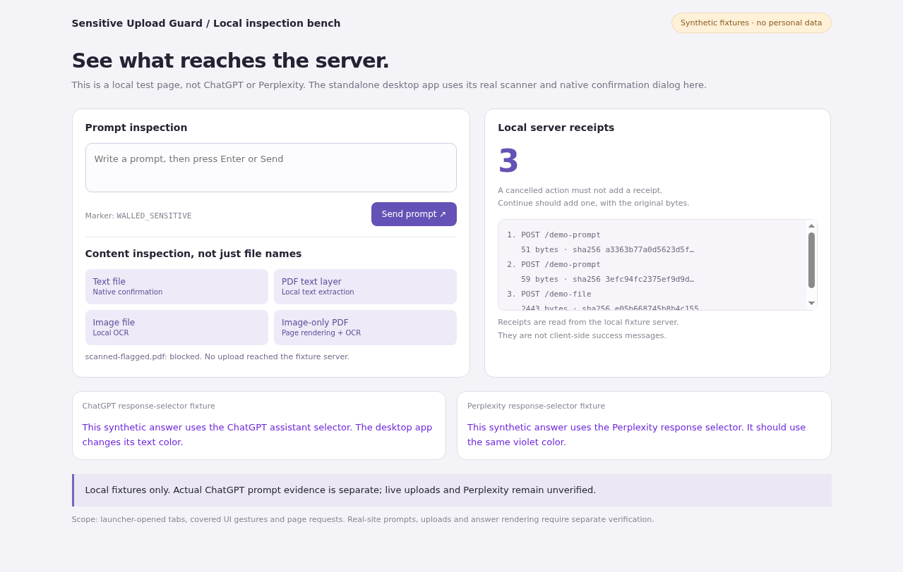

# Sensitive Upload Guard

A standalone Node.js desktop application for a dedicated **real Chrome** window. No browser extension, plugin, native-messaging registration, local proxy, or certificate installation is required.

The app checks prompts and supported files for the exact, case-sensitive marker `WALLED_SENSITIVE`. A match opens a native desktop **Continue / Cancel** dialog. Assistant responses are restyled in violet.

## Verification status

**78/78 local checks pass with Chrome's normal sandbox enabled.** The actual logged-out ChatGPT prompt flow also passes: clean submission, native Cancel and Continue, and violet responses. Anonymous PNG upload through the normal **Add photos** menu was also verified, including native Cancel/Continue, a successful binary-upload response, and a visible attachment. This is **not a claim of complete live acceptance**. The separate **Add files** route requires login; text/PDF and signed-in upload flows were not verified. The actual-app Perplexity route remained at a browser challenge after two attempts, so its prompt, upload, and response behavior remain unverified.

The demo separates real ChatGPT footage from explicitly labeled local file fixtures. Local fixtures are not proof of either service's upload behavior. See [the evidence guide](evidence/README.md) for recorded results and outstanding checks.



## Quick start

```sh
npm ci --omit=dev
npm start
```

Or use `./start.sh` on Linux/macOS, or `start.cmd` on Windows. The wrapper installs dependencies if `node_modules` is absent.

### Requirements

- Node.js **22.13.0 or newer**, with npm.
- Installed Google Chrome or Chromium. The app does not download a browser.
- Linux: `zenity` and a graphical desktop.
- Internet access for initial dependency installation and the AI sites. Content inspection uses local package assets and local English OCR data after installation.

**Executed on:** Linux, Node.js 22.23.5, Chrome 157, and Zenity. Windows and macOS native-dialog adapters are included but **untested**. Windows uses Windows Forms with labeled Continue and Cancel buttons; macOS uses `osascript`. Do not infer platform support from the presence of these adapters.

If the browser is installed elsewhere, set `CHROME_PATH`:

```sh
CHROME_PATH=/usr/bin/chromium npm start
```

### Use

1. Open ChatGPT or Perplexity with the launcher's buttons.
2. If required, sign in with your own existing account in that temporary session. Account creation is not part of setup.
3. Type a prompt, choose a supported file, paste an image, or drop a file.
4. A marker hit opens a native desktop dialog. **Cancel** blocks the attempt; **Continue** releases the original content. You can edit and retry after Cancel.
5. Close the app's browser windows or press Ctrl+C in the launching terminal to exit.

Each launch uses a fresh profile, separate from normal Chrome. Normal exit closes Chrome and removes the temporary profile. Sign-in sessions are not retained. An unexpected process or OS termination can leave a `walled-guard-*` directory in the OS temporary folder; remove it after confirming the app is closed.



## Security boundary

Read this before using sensitive content:

- Use **launcher-opened tabs**. The controller first opens a blank tab, installs the guard, then navigates to an allowed service.
- Protection covers supported destinations in those tabs, covered UI gestures, and page-context request hooks. It does not protect ordinary Chrome windows or pre-existing sessions.
- Arbitrary new nonblank tabs and popups have an initial-script race during Chrome auto-attachment. They are **outside the verified boundary**. Reopen the service through the launcher instead.
- This is an interaction guard, **not a hardened network firewall or enterprise DLP agent**. A hostile page, a DevTools user, or an arbitrary programmatic worker send can bypass JavaScript-level controls.
- Current anonymous ChatGPT prompt/response markup and PNG selection through Add photos were exercised live. Text/PDF, authenticated and paste/drop upload flows, and Perplexity still need separate live checks. Sites can change their DOM or reject synthetic replay events.

## Implementation and acceptance matrix

| Area | Implementation | Evidence and limit |
|---|---|---|
| Prompt text | Exact marker match before Enter or detected send-button replay; additional fetch, XHR, and WebSocket page hooks | Actual anonymous ChatGPT clean send, native Cancel and Continue; local regressions |
| Text files | Strict UTF-8 content scanning, not filename matching | Local native confirmation and original-byte receipt hashes |
| PDF files | PDF.js text extraction; page rasterization and OCR when no text-layer hit is found | Local text-PDF and image-only PDF fixtures |
| Images | Local Tesseract English OCR for PNG, JPEG, GIF, BMP, and WebP | Flagged and clean PNG locally; actual anonymous ChatGPT flagged-PNG Cancel/Continue and completed upload; other formats not independently exercised |
| Native confirmation | Zenity Continue / Cancel; dismissal, timeout, or unavailable dialog blocks | Real Linux dialogs, including actual ChatGPT prompts |
| Response color | Inspector stylesheet with ChatGPT and Perplexity selector families | Actual ChatGPT answers violet; local selector/CSP fixtures; live Perplexity unverified |
| Live file uploads | Input, paste, and drop gates implemented | Anonymous ChatGPT PNG selection verified; **text/PDF, signed-in and paste/drop uploads remain unverified**, as do all Perplexity uploads |
| Live Perplexity | Launcher entry point and selector adapter implemented | **Challenge-blocked; prompts, files, and response color unverified** |

Clean supported files pass after inspection without a confirmation. Clean prompt text does not create a dialog. The launcher activity counter counts inspection batches, not every network request or every clean prompt.



## Architecture

```text
Node desktop controller
  ├── installed Chrome, fresh temporary profile
  ├── CDP over inherited OS pipes, no debugging TCP listener
  ├── blank managed tab configured before service navigation
  ├── document-start gesture and page-request hooks
  │     └── bounded inspection messages through a Runtime binding
  ├── scanner worker thread
  │     ├── strict UTF-8 text
  │     ├── PDF.js extraction and page rasterization
  │     └── local Tesseract English OCR
  ├── serialized native Continue / Cancel dialogs
  └── inspector response stylesheet, without rewriting CSP
```

### Before transmission

The page hook captures composer Enter, detected send-button clicks, file-input **input and change** events, file paste, and file drop. It holds the original UI event until inspection completes. Capturing `input` is important: a site's worker upload can start before its `change` listener runs.

Page-context `fetch`, `XMLHttpRequest.send`, and relevant WebSocket payloads add another inspection layer. Workers are **not globally intercepted**. A worker upload triggered by a covered file-selection gesture is held at that earlier gesture instead. Arbitrary programmatic worker sends are excluded.

Continue replays the approved operation without changing its content. Send-button discovery includes named selectors and a small composer-local fallback for previously observed unlabeled controls. Site markup and event-trust changes may require adapter updates.

### No broad approval window

A gesture approval is bound to:

- Exact prompt text, or SHA-256 over **every byte** of a file.
- The current origin.
- A single subsequent use, expiring after 15 seconds.

Every candidate in a request must match separately. Another flagged field, a same-name/same-size different file, another destination origin, or changed composer text cannot borrow that approval. Duplicate-content items use counted matches rather than a wildcard. Replayed UI events use a private WeakSet, not a writable replay flag.

### Failure behavior and bounds

- 20 MiB per file; 50 pages per PDF; 25 megapixels per raster/page render.
- 16 candidates per inspection batch. Aggregate file-transfer and text limits are enforced in the desktop process too.
- Scanner errors, invalid formats, unsupported binary files, oversized input, hash failures, and missing decisions block the covered operation. Files are not silently skipped.
- Scanning is serialized in a worker thread with a 120-second job timeout and a V8 heap limit. An entire inspection expires after 150 seconds. Native dialogs use only the time remaining and expire to Cancel. The page wait has a separate 180-second fail-closed cap.
- A browser status notice explains scan/block outcomes. It is **not** the confirmation dialog; the decision uses the native desktop UI.

### Privacy and browser security

- The application does not write prompt text or file bytes to its activity logs.
- PDF/OCR inspection runs locally. Content reaches the AI service only when the covered operation is released.
- Chrome uses an isolated temporary profile and inherited debugging pipes, with no unauthenticated debugging TCP port.
- No root certificate, local proxy, trust-store change, CSP-header rewrite, or web-security-disable flag is used.
- The production launcher keeps Chrome's normal sandbox. The final local suite and actual ChatGPT recording both ran without `--no-sandbox`.
- A test-only sandbox-bypass option exists for disposable bench environments. It is rejected outside bench mode and is not the default.
- Same-user local process compromise and hostile-page tampering remain outside the boundary.

## Reproduce the tests

Install dev dependencies and Linux graphical test prerequisites: `Xvfb`, `xdotool`, and `zenity`. `ffmpeg` is needed for recordings.

```sh
npm ci
npm test
```

The suite runs **78 checks**: six bootstrap/CSP checks, 37 baseline checks, and 35 additional regressions. It launches real Chrome and real native dialogs against local HTTP fixtures. Server receipts check that canceled bodies did not arrive; SHA-256 checks compare original file bytes. It also verifies temporary-profile cleanup. **`npm test` does not contact the live AI services.**

Only if Chrome cannot start its normal sandbox in a disposable test environment:

```sh
WALLED_TEST_NO_SANDBOX=1 npm test
```

For an interactive local bench, start `node test/server.js`, then `npm run bench`. The bench allowlist is disabled during normal operation. To record the labeled local fixture:

```sh
node test/record-demo.js
```

### Optional live ChatGPT smoke test

```sh
WALLED_EVIDENCE_DIR=/tmp/walled-live node test/live-chatgpt.js
```

This separate test sends two **public dummy prompts** to anonymous ChatGPT and records native Cancel/Continue, network evidence, and computed response colors. It requires live service access and can fail if the UI, availability, or sign-in requirements change. It does not test authenticated uploads and does not retry Perplexity's stopped challenge route. It counts distinct protocol request IDs and URLs so duplicate diagnostic-session observations are not mistaken for additional sends.



## Outstanding acceptance work

1. Verify native-app Perplexity prompt decisions and response recoloring once its normal access route is available. Two unsuccessful checkbox attempts are recorded; this is not a passing test.
2. Verify remaining text/PDF and signed-in file selection, paste/drop, upload transport, and successful service behavior on both sites using permitted dummy files and existing accounts. Anonymous ChatGPT PNG upload is already recorded separately.
3. Resolve or explicitly retain the arbitrary-new-tab/popup exclusion before making any broader protection claim.
4. Execute the Windows and macOS adapters before claiming cross-platform support.

The repository and demo deliberately report these gaps. They do not promise complete protection or a hiring outcome.

## Source map

- `app/main.js`: lifecycle, origins, inspection orchestration, response stylesheet.
- `app/chrome-pipe.js`: CDP pipe client, no browser-automation runtime dependency.
- `app/hook.js`: UI gates, body inspection, operation-bound approvals and replay.
- `app/scanner*.js`: worker isolation and text/PDF/OCR scanning.
- `app/dialog.js`: native dialog adapters.
- `app/home.html`: launcher and aggregate activity.
- `test/`: synthetic servers, native-dialog controls, transport adapter, and regressions.
- `evidence/`: screenshots, local test results, live ChatGPT results, and verification guide.
- `THIRD_PARTY.md`: dependency and license notes.

Author: Vedant Kumar.
